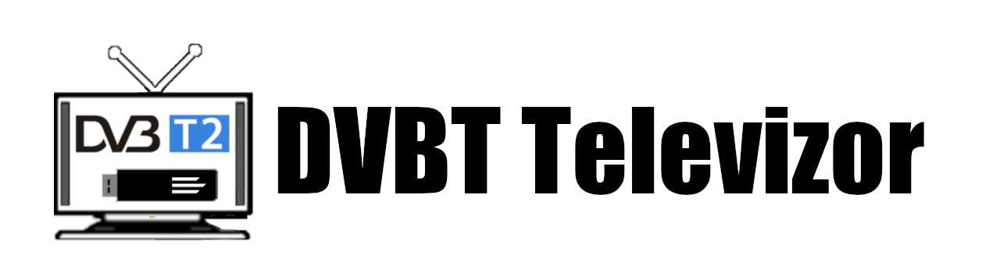
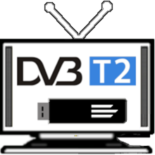

# DVBT Televizor

##  EN

DVBT/FM/DAB player for Android

The app offers partial Windows support through MAUI, but primarily focuses on Android.

## Software requirements:
- "DVB-T Driver": https://play.google.com/store/apps/details?id=info.martinmarinov.dvbdriver
- "RTL SDR driver": https://play.google.com/store/apps/details?id=marto.rtl_tcp_andro

## HW requirements:
- Compatible USB DVBT/DVBT2/RTL-SDR tuner

## Key Features:
- free, no ads
- DVBT and DVBT2
- FM mono/stereo
- DAB/DAB+
- supporting external keyboards and remote controls connected as keyboard (usb, bluetooth)
- recording
- automatic and manual tuning
- possibility to export/import tuned channels
- EPG for current/next program (chinese characters are not supported)
- possibility to enlarge the font (ideal for tablets and TVs)
- Android 5.0 and higher for architectures: armeabi, armeabi-v7a, x86, x86_x64, arm64-v8a
- subtitles
- teletext
- remote access from other (Android) device
    * Remote Televizor - Google Play: https://play.google.com/store/apps/details?id=net.petrjanousek.RemoteTelevizor
    * Remote Televizor - github (apk, Windows): https://github.com/petrj/RemoteTelevizor/releases/tag/6.0

##  CZ

Přehrávač DVBT/FM/DAB pro Android

Aplikace běží pod Windows díky MAUI technologii, ale primárně míří na platformu Android.

## SW požadavky:
- "DVB-T Driver": https://play.google.com/store/apps/details?id=info.martinmarinov.dvbdriver
- "RTL SDR driver": https://play.google.com/store/apps/details?id=marto.rtl_tcp_andro

## HW požadavky:
Kompatibilní USB DVBT/DVBT2/RTL-SDR tuner pro Android

## Klíčové prvky:
- zdarma a bez reklam
- DVBT a DVBT2
- FM mono/stereo
- DAB/DAB+
- podpora klávesnic a dálkových ovladačů připojených jako klávesnice (usb, bluetooth)
- nahrávání vysílání (interní i externí úložiště)
- automatické i ruční ladění
- možnost importovat/exportovat naladěné kanály
- EPG pro právě probíhající/následující program (bez podpory čínských znaků)
- možnost zvětšení fontu (ideální pro tablety a TV)
- pro Android 5.0 a vyšší (architektury: armeabi, armeabi-v7a, x86, x86_x64, arm64-v8a)
- titulky
- volba audio stopy
- teletext
- podpora vzdáleného ovládání z jiného (Android) zařízení
    * Remote Televizor - Google Play: https://play.google.com/store/apps/details?id=net.petrjanousek.RemoteTelevizor
    * Remote Televizor - github (apk, Windows): https://github.com/petrj/RemoteTelevizor/releases/tag/6.0

